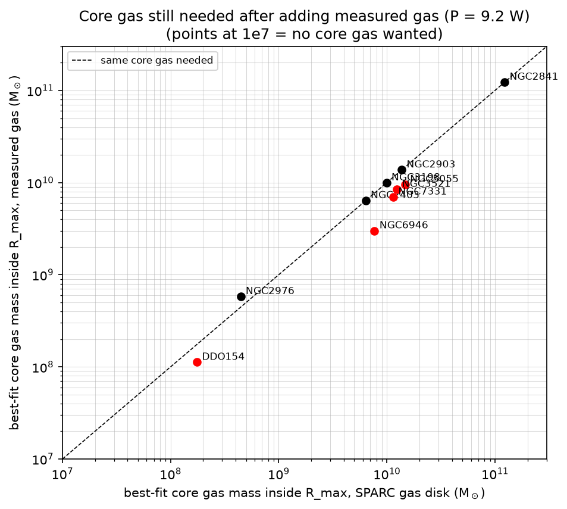

# 3D gas test: 10 SPARC galaxies with THINGS HI + HERACLES CO

**Question.** The dark-mass model (ρ_dm = (P/c³) n^(2/3)) fits SPARC about as well as MOND, but only with a lot of unobserved spherical "core gas". The thesis is that measuring *all* the gas properly in 3D (HI + H2 + ionized, each phase with its own thickness) would improve the fit and reduce the need for that core gas. This tests the thesis on every SPARC galaxy that has both a THINGS HI map and a HERACLES CO map. Two are left out: NGC 4214 (inclination 15°) and NGC 2366 (SPARC quality 3).

**Failure condition (written down before reading the results).** If complete measured gas gives no improvement in fit and adds little gas compared with what the core term supplies, then measured gas does not support the core-gas term. In that case the core gas stays an unobserved component the model needs, not a stand-in for gas we already know about.

## Setup

All runs: P = 9.2 W fixed, CGM off, Υ_disk = 0.5, Υ_bulge = 0.6, the same brute-force grid (`num_minutes=8`, z layers sinh-spaced with A = 0.02 kpc, see "Grid note" below). Residuals are taken at the observed radii, using the model's own 3D gas gravity (`Vgas_test`) in every variant.

| variant | gas disk | core gas |
|---|---|---|
| a0 | SPARC Σ_gas column (inverted from Lelli Vgas), h_z = 0.196 R_d^0.633 | off |
| **a** (current) | SPARC Σ_gas column | canonical: 0.6 + 0.09(9.5 − log M_b), β 1.93, r_core_factor 2.5 |
| **b** | measured HI + H2 + ionized | off |
| **c** | measured HI + H2 + ionized | canonical |

"Best n0" comes from scanning the core central density (n0 = 0 and 12 values from add_core 0.15 to 2.2; negative n0 skipped) with everything else fixed. "Core mass" is the extra gas the best-fit core puts inside a sphere of radius R_max.

## Results: all 10 galaxies

Mean |V_obs − V_model| (km/s) at observed radii, sorted by V_max. Masses are in M☉ inside R_max, ×1.33 for helium; the measured mass includes the assumed ionized layer. Full numbers, including χ², are in `results.json`; this table is `summary_table.md`.

| galaxy | V_max | a0 SPARC, no core | a SPARC + core | b measured, no core | c measured + core | MOND | best n0 SPARC (MAE) | best n0 measured (MAE) | core mass SPARC | core mass measured | gas SPARC disk | gas measured |
|---|---|---|---|---|---|---|---|---|---|---|---|---|
| DDO154 | 48 | 10.8 | 5.1 | 6.4 | 2.8 | 4.1 | 1.39 (3.8) | 0.89 (2.5) | 1.8e8 | 1.1e8 | 2.4e8 | 4.1e8 |
| NGC2976 | 89 | 8.8 | 3.3 | 10.7 | 4.6 | 5.3 | 1.00 (1.5) | 1.30 (1.8) | 4.5e8 | 5.8e8 | 2.6e8 | 2.0e8 |
| NGC2403 | 136 | 30.7 | 13.2 | 30.4 | 13.7 | 5.6 | 1.24 (5.6) | 1.24 (5.4) | 6.4e9 | 6.4e9 | 5.4e9 | 4.3e9 |
| NGC3198 | 157 | 33.5 | 4.6 | 26.1 | 7.8 | 8.1 | 0.49 (4.6) | 0.49 (7.8) | 9.9e9 | 9.9e9 | 1.4e10 | 1.7e10 |
| NGC6946 | 181 | 26.8 | 10.5 | 12.9 | 23.8 | 15.5 | 0.33 (3.7) | 0.13 (6.3) | 7.7e9 | 3.0e9 | 4.1e9 | 1.0e10 |
| NGC5055 | 206 | 24.2 | 25.3 | 21.8 | 31.9 | 29.3 | 0.23 (9.0) | 0.15 (14.4) | 1.5e10 | 9.5e9 | 1.5e10 | 2.0e10 |
| NGC2903 | 216 | 41.8 | 12.7 | 37.8 | 12.7 | 12.4 | 0.47 (12.7) | 0.47 (12.7) | 1.4e10 | 1.4e10 | 3.8e9 | 5.5e9 |
| NGC3521 | 220 | 25.6 | 6.8 | 18.2 | 7.4 | 5.9 | 0.47 (6.8) | 0.32 (7.2) | 1.2e10 | 8.5e9 | 5.0e9 | 8.5e9 |
| NGC7331 | 257 | 31.5 | 30.3 | 26.7 | 36.0 | 25.4 | 0.13 (13.3) | 0.08 (16.2) | 1.1e10 | 7.0e9 | 1.5e10 | 2.1e10 |
| NGC2841 | 323 | 106.5 | 58.3 | 119.5 | 66.9 | 56.7 | 1.54 (18.1) | 1.54 (14.2) | 1.2e11 | 1.2e11 | 4.1e10 | 1.5e10 |

Sensitivity of variant (b) (MAE km/s):

| galaxy | b | α_CO × 0.5 | α_CO × 2 | no ionized layer | MOND with measured gas |
|---|---|---|---|---|---|
| DDO154 | 6.4 | 6.5 | 6.4 | 9.5 | 5.8 |
| NGC2976 | 10.7 | 11.2 | 9.7 | 11.2 | 4.4 |
| NGC2403 | 30.4 | 31.1 | 29.1 | 34.0 | 7.3 |
| NGC3198 | 26.1 | 27.2 | 24.0 | 30.3 | 10.8 |
| NGC6946 | 12.9 | 16.1 | 12.5 | 16.6 | 24.6 |
| NGC5055 | 21.8 | 21.5 | 23.2 | 25.1 | 33.8 |
| NGC2903 | 37.8 | 38.7 | 36.8 | 40.4 | 13.4 |
| NGC3521 | 18.2 | 21.2 | 12.9 | 19.5 | 7.7 |
| NGC7331 | 26.7 | 28.4 | 24.2 | 31.2 | 29.0 |
| NGC2841 | 119.5 | 120.3 | 118.2 | 122.4 | 62.8 |



Per-galaxy plots: `<GAL>_3dgas_variants.png` (variants a/b/c, with HI, H2, ionized and core gas shown separately), `<GAL>_core_scan.png`, and `<GAL>_profiles.png` (measured profiles against SPARC Σ and Leroy et al. 2008).


## Verdict against the failure condition

**Pattern across the 10 galaxies:**
- **Measured gas without core (b vs a0)** improves the fit in 7 of 10 galaxies. It is unchanged in NGC 2403 and worse in NGC 2976 and NGC 2841. It beats the current model (a) only in NGC 5055 and NGC 7331, where the canonical core overshoots (a is no better than a0 there). Elsewhere it comes close only in DDO 154 and NGC 6946.
- **Best-fit core gas** drops in 5 galaxies: DDO 154 by 40%, NGC 6946 by 60%, NGC 5055 by 35%, NGC 3521 by 30%, NGC 7331 by 35%. It is unchanged in NGC 2403, 3198, 2903 and 2841, and rises in NGC 2976. The median reduction is about 15%. **No galaxy gets rid of the core term.**
- **The core gas still needed is large compared with the measured gas.** In the L* spirals it is about 0.5–2.5× all the measured gas: NGC 2403 6.4e9 vs 4.3e9, NGC 2903 1.4e10 vs 5.5e9, NGC 3198 9.9e9 vs 1.7e10.
- **Best fits with measured gas** (best n0) are worse than with SPARC gas in 6 of 10 galaxies. In NGC 3198, 6946, 5055, 3521 and 7331, the measured H2 is centrally concentrated and the remaining shortfall is at mid and outer radii.

**By galaxy, against the failure condition:**
- **Failure condition met:** NGC 2403, NGC 2976 and NGC 2903. Measured gas gives little or no improvement, and the core gas needed is unchanged or larger.
- **Partial, assumption-dependent support:** NGC 6946, NGC 3521, NGC 5055, NGC 7331 and DDO 154. Here the measured gas does part of the core term's job. The gain depends on the Galactic α_CO in the centres, which is likely too high in NGC 6946 (Sandstrom et al. 2013), and on the assumed ionized layer: removing it worsens (b) by 0.5–4.5 km/s in every galaxy.
- **NGC 3198:** the fit improves, but the core need doesn't change. The measured gas mass is higher than SPARC's, but in the wrong place.
- **NGC 2841: uninformative.** Every variant, including MOND, is off by more than 50 km/s. That points to the stellar mass model (fixed Υ, a large bulge) or the distance, not the gas.

**Overall:** measured 3D gas moves most galaxies in the direction the thesis predicts, but only by a small fraction of what is needed. Known disk gas, even with generous H2 and ionized-gas assumptions, does not replace the spherical core term. Within this test, the core gas has to be a real but so far unobserved component of about 1e10 M☉ in L* galaxies, extended over tens of kpc. That makes it a prediction for halo gas (warm or hot CGM, CO-dark gas), not a correction to disk gas measurements. MOND, with no extra component, fits 6 of the 10 at least as well as the current model (a).

## Assumptions

- **Distances:** SPARC values, so radii match the rotation curves. Several differ from the THINGS distances, e.g. NGC 2903 6.6 vs 8.9 Mpc and NGC 3521 7.7 vs 10.7 Mpc.
- **Map geometry:** de Blok et al. 2008, Table 2, listed in `GALAXIES` in `gas3d_build_profiles.py`. The rotation curves are SPARC's own, at SPARC inclinations. For NGC 6946 the inclination difference (32.6° vs 38°) alone is a ~14% change in deprojected V_obs.
- **HI:** N_HI = 1.823e18 ∫T_B dv, with THINGS natural-weighted beams taken from the map headers. Face-on Σ = N cos i. Helium enters as ×1.33 in the model's mass, as for SPARC. Beyond the last ring with ≥60% azimuthal THINGS coverage, HI falls back to the SPARC Σ column. That only affects NGC 2403 beyond 23.6 kpc and NGC 5055 beyond 52 kpc.
- **H2:** α_CO(1-0) = 4.35 M☉ pc⁻² (K km/s)⁻¹ including He (Bolatto et al. 2013), uncertain by ±0.3 dex. R21 = CO(2-1)/CO(1-0) = 0.7 (den Brok et al. 2021: 0.65 ± 0.2). This gives Σ_H2(incl. He) = 6.2 I_CO(2-1). H2 is counted as 2 H nuclei per molecule, the same convention as the SPARC Σ column. If each molecule counted as one particle, the H2 contribution to n^(2/3) would drop by 2^(2/3) = 1.6. CO is set to zero in rings HERACLES covers less than 60% of, and to zero where it is undetected (DDO 154).
- **Ionized gas:** not measured. Σ_ion = 0.25 Σ_HI with an exponential scale height of 1 kpc. This follows the Milky Way, where pulsar dispersion measures give N_e ≈ 1.4e20 cm⁻² through the disk against N_HI ≈ 6e20 cm⁻².
- **Vertical profiles** (exponential, renormalised on the actual z layers so each phase keeps its column): HI h = 0.15 + 0.025 R kpc (flaring; this reaches ~1.9 kpc at 70 kpc in NGC 2841), H2 h = 0.05 kpc, ionized h = 1.0 kpc.
- **Axisymmetry:** measured profiles are azimuthal ring averages, like the rotation curve. Clumping at map resolution, ⟨Σ^(2/3)⟩/⟨Σ⟩^(2/3), is mostly 0.9–0.97 (column `clump_HI_H2` in the CSVs). Including it would *lower* the dark mass from measured gas by a few percent. That is not applied here.

## Data checks

- **Per-phase gas curves.** In NGC 2403 the measured H2 rises to 15.4 km/s at 4 kpc and falls to ~6.7 km/s at 15 kpc. This matches Frank et al. (2016, Fig. 10: ~15–16 km/s at 3.5–4 kpc, ~6 km/s at 18 kpc), so H2 is included correctly. It barely shows in the summed gas line because velocities add in quadrature.
- **HI and H2 profiles** match Leroy et al. (2008) after rescaling their radii to the SPARC distances (`*_profiles.png`). Integrated THINGS HI masses agree with Walter et al. 2008 rescaled to the SPARC distances. For example: NGC 2403 2.5e9, NGC 6946 3.6e9, NGC 3198 9.8e9, NGC 7331 9.1e9 M☉ (hydrogen only).
- **THINGS is not "complete" HI.** SPARC's HI masses often come from deeper WSRT data and are higher, e.g. 3.2e9 vs 2.5e9 M☉ for NGC 2403 and 5.7e9 vs 3.6e9 for NGC 6946. The missing HI is mostly diffuse and outer/extraplanar. It would help outer deficits somewhat, but cannot reach the ~1e10 M☉ core masses.
- **Side finding:** the SPARC Σ_gas column made by `calc_gas_checkit.py` seems to inflate the gas in some galaxies. NGC 2403: 4.0e9 M☉ (H only) to R_max, against SPARC M_HI 3.2e9 and THINGS 2.5e9. NGC 2841: the SPARC-disk gas inside R_max is 4.1e10 M☉, against 1.5e10 measured (SPARC M_HI is 9.8e9). Worth checking the Vgas inversion for these galaxies.

## Grid note

All variants here use a new option, `z_stretch_kpc=0.02` (sinh-spaced z layers). It resolves the 50 pc H2 layer without losing mass. With the default uniform z grid at `num_minutes=8`, layers are ≈0.23 kpc thick or more, about one disk scale height. A 50 pc H2 layer would then get ~2× its mass and be smeared in n^(2/3). As a result, variant (a) here is not numerically identical to a default-grid canonical run. In a low-resolution check, the uniform vs stretched grid moved variant (a) by 0.7 km/s (NGC 6946) and 2.4 km/s (NGC 2403). It is worth checking how sensitive the full-SPARC fit is to this.

## Data sources

- THINGS HI moment-0 maps, natural weighting (Walter et al. 2008, AJ 136, 2563): https://things.www3.mpia.de/Data_files/ — `<GAL>_NA_MOM0_THINGS.FITS`
- HERACLES CO(2-1) moment-0 maps (Leroy et al. 2009, AJ 137, 4670): https://www.iram.fr/ILPA/LP001/ — `<gal>_heracles_mom0.fits.gz` (+ `emom0`)
- Leroy et al. 2008 radial profiles (cross-check): https://cdsarc.cds.unistra.fr/ftp/J/AJ/136/2782/
- Geometry: de Blok et al. 2008, AJ 136, 2648, Table 2
- Raw downloads live in `data_3dgas/raw/` (git-ignored, ~60 MB). FITS files were read only with `python -I`.

## Reproduce

```bash
.venv/bin/pip install astropy
.venv/bin/python -I sparc/gas3d_build_profiles.py   # FITS -> sparc/gas3d/<GAL>_profiles.csv/.png
.venv/bin/python sparc/gas3d_test.py                # all variants + core scan for 10 galaxies, ~30-40 min
```
