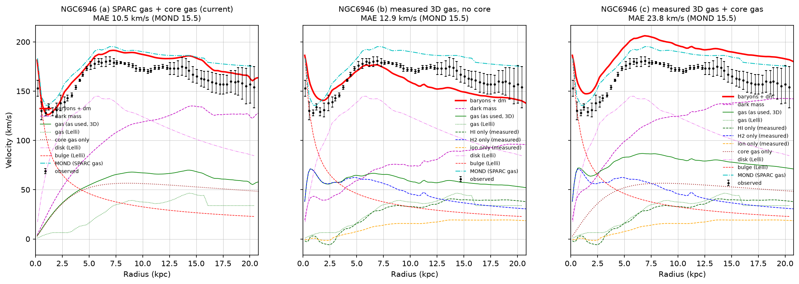
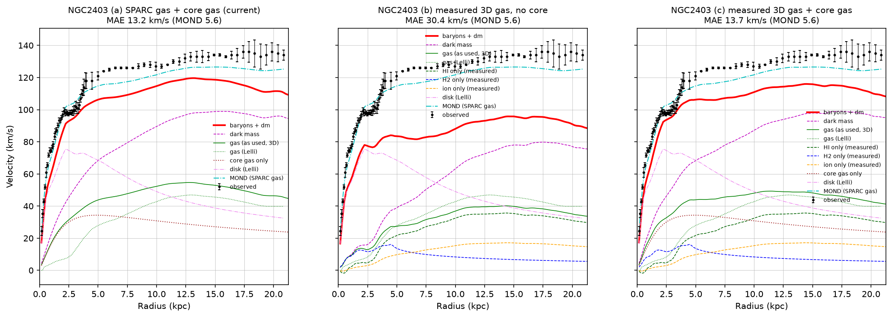
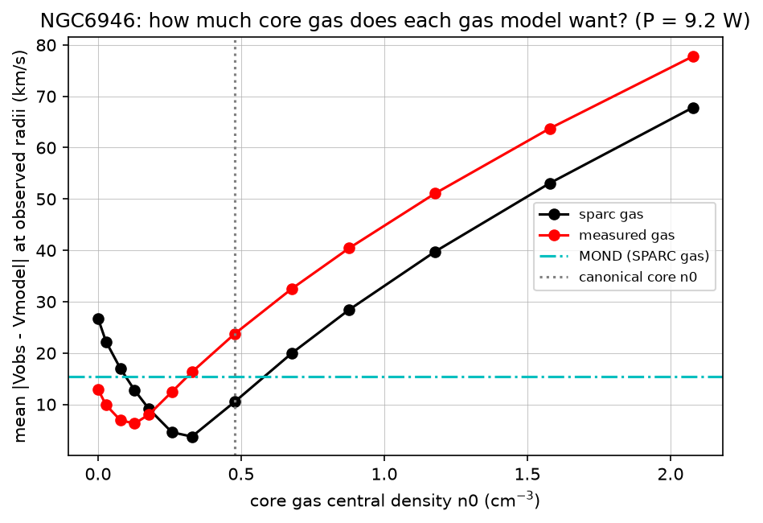
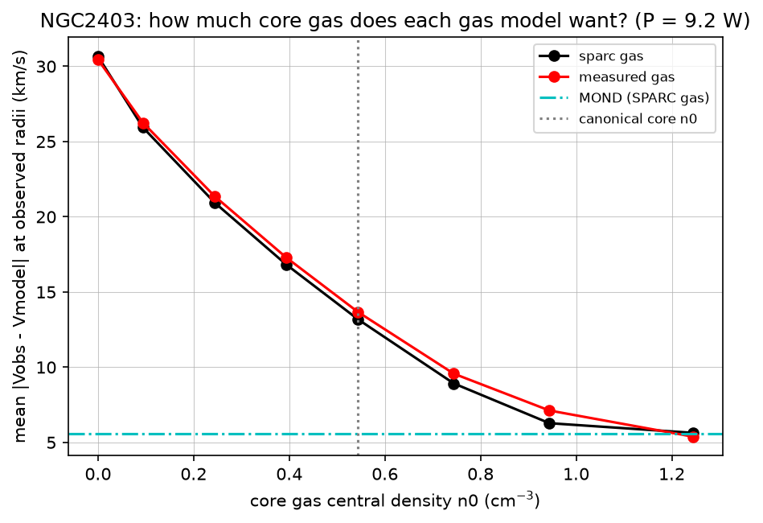

# 3D gas test: NGC 6946 and NGC 2403

**Question.** The dark-mass model (ρ_dm = (P/c³) n^(2/3)) fits SPARC about as well as MOND, but only with a lot of unobserved spherical "core gas". The thesis is that measuring *all* the gas properly in 3D (HI + H2 + ionized, each phase with its own thickness) would improve the fit and reduce the need for that core gas. This is a test of that thesis on two well-observed galaxies.

**Failure condition (written down before reading the results).** If complete measured gas gives no improvement in fit and adds little gas compared with what the core term supplies, then measured gas does not support the core-gas term. In that case the core gas stays an unobserved component the model needs, not a stand-in for gas we already know about.

## Setup

All runs: P = 9.2 W fixed, CGM off, Υ_disk = 0.5, Υ_bulge = 0.6, the same brute-force grid (`num_minutes=8`, z layers sinh-spaced with A = 0.02 kpc, see "Grid note" below). Residuals are taken at the observed radii, using the model's own 3D gas gravity (`Vgas_test`) in every variant.

| variant | gas disk | core gas |
|---|---|---|
| a0 | SPARC Σ_gas column (inverted from Lelli Vgas), h_z = 0.196 R_d^0.633 | off |
| **a** (current) | SPARC Σ_gas column | canonical: 0.6 + 0.09(9.5 − log M_b), β 1.93, r_core_factor 2.5 |
| **b** | measured HI + H2 + ionized | off |
| **c** | measured HI + H2 + ionized | canonical |

## Results

Mean |V_obs − V_model| (km/s) at observed radii. χ²/pt is in `results.json`.

| | NGC 6946 | NGC 2403 |
|---|---|---|
| a0 SPARC gas, no core | 26.8 | 30.7 |
| **a SPARC gas + core (current)** | **10.5** | **13.2** |
| **b measured gas, no core** | **12.9** | **30.4** |
| **c measured gas + core** | **23.8** (overshoots) | **13.7** |
| b with α_CO × 0.5 | 16.1 | 31.2 |
| b with α_CO × 2 | 12.5 | 29.1 |
| b without ionized layer | 16.6 | 34.0 |
| MOND, SPARC gas | 15.5 | 5.6 |
| MOND, measured gas | 24.6 | 7.3 |

Gas mass inside a sphere of radius R_max (M☉, ×1.33 for helium):

| | NGC 6946 | NGC 2403 |
|---|---|---|
| SPARC Σ disk | 4.1e9 | 5.4e9 |
| measured HI + H2 + ionized | 10.2e9 | 4.3e9 |
| canonical core gas adds | 11.2e9 | 2.8e9 |

**How much core gas is still needed?** I scanned the core central density n0 with everything else fixed (see `*_core_scan.png`; the scan is coarse, ±0.1 cm⁻³):

| | best n0 with SPARC gas | best n0 with measured gas |
|---|---|---|
| NGC 6946 | ≈0.33 (MAE 3.7), core ≈ 8e9 M☉ | ≈0.18 (MAE 8.0), core ≈ 4e9 M☉ |
| NGC 2403 | ≥1.24, the edge of the scan (MAE 5.6) | ≥1.24, the edge of the scan (MAE 5.4) |






## Verdict against the failure condition

- **NGC 2403: the failure condition is met.** HERACLES shows almost no H2 (≈1e8 M☉). THINGS HI is *less* than the SPARC Σ column. Even with the assumed ionized layer, measured gas does not change the fit (30.4 vs 30.7 km/s without core). The core gas needed is unchanged and larger than the canonical value: the best fit wants n0 ≳ 1.2, which is more unseen gas than all the measured gas combined. For this galaxy, measured gas gives no support to the core-gas term. MOND fits it at 5.6 km/s with no extra component.
- **NGC 6946: partial support, but it depends on the assumptions.** This galaxy is H2-rich. Measured gas alone (b) cuts the no-core error from 26.8 to 12.9 km/s, and the best-fit core gas drops by about half (≈8e9 → ≈4e9 M☉). However:
  - the best measured + core fit (8.0) is worse than the best SPARC + core fit (3.7);
  - the canonical core on top of measured gas overshoots badly (c = 23.8);
  - the shape is wrong in a specific way. Measured H2 is concentrated in the centre, so (b) overshoots at R ≈ 1–2 kpc and falls below the data beyond ≈ 8 kpc. The extended core sphere fills an *outer* deficit that the measured gas does not;
  - the gain relies on the Galactic α_CO in the centre. Sandstrom et al. (2013) find α_CO is 5–10× lower there, and α × 0.5 already raises the error to 16.1. It also relies on the assumed ionized layer: without it the error is 16.6;
  - MOND gets *worse* with the measured H2 (15.5 → 24.6). So the H2 load in the centre is probably overestimated for any dynamics.
- **Overall:** this test does not confirm the thesis. One galaxy fails it outright. The other moves in the predicted direction, but only part of the way, and the size of the move depends on α_CO and the ionized-gas assumption, both of which are uncertain at the factor-2 level.

## Assumptions

- **Distances** (SPARC, so radii match the rotation curves): NGC 2403 3.16 ± 0.16 Mpc (TRGB). NGC 6946 5.52 ± 1.66 Mpc. THINGS used 3.2 and 5.9 Mpc.
- **Map geometry** (de Blok et al. 2008, Table 2): NGC 2403 i = 62.9°, PA = 123.7°, centre 07:36:51.1 +65:36:02.9. NGC 6946 i = 32.6°, PA = 242.7°, centre 20:34:52.2 +60:09:14.4. The rotation curves are SPARC's own, at i = 63° and 38°. For NGC 6946 the inclination difference alone (32.6° vs 38°) is a ~14% change in deprojected V_obs. This is the largest single systematic for that galaxy.
- **HI:** N_HI = 1.823e18 ∫T_B dv. THINGS natural-weighted beams are 8.75″×7.65″ (NGC 2403) and 6.04″×5.61″ (NGC 6946). Face-on Σ = N cos i. Helium enters as ×1.33 in the model's mass, as for SPARC.
- **H2:** α_CO(1-0) = 4.35 M☉ pc⁻² (K km/s)⁻¹ including He (Bolatto et al. 2013), uncertain by ±0.3 dex. R21 = CO(2-1)/CO(1-0) = 0.7 (den Brok et al. 2021: 0.65 ± 0.2). This gives Σ_H2(incl. He) = 6.2 I_CO(2-1). H2 is counted as 2 H nuclei per molecule, the same particle convention as the SPARC Σ column (hydrogen nuclei). If each molecule counted as one particle, the H2 contribution to n^(2/3) would drop by 2^(2/3) = 1.6. The CO map is set to zero where HERACLES covers < 60% of a ring (beyond ~4.4 kpc in NGC 2403, ~11 kpc in NGC 6946).
- **Ionized gas:** not measured. Σ_ion = 0.25 Σ_HI with an exponential scale height of 1 kpc. This follows the Milky Way, where pulsar dispersion measures give N_e ≈ 1.4e20 cm⁻² through the disk against N_HI ≈ 6e20 cm⁻².
- **Vertical profiles** (exponential, renormalised on the actual z layers so each phase keeps its column): HI h = 0.15 + 0.025 R kpc (flaring, 0.15 → 0.65 kpc), H2 h = 0.05 kpc, ionized h = 1.0 kpc.
- **Axisymmetry:** measured profiles are azimuthal ring averages, like the rotation curve. Clumping at map resolution, ⟨Σ^(2/3)⟩/⟨Σ⟩^(2/3), is 0.9–0.97 over most of the disk and down to ~0.6 in a few rings (column `clump_HI_H2` in the CSVs). Including it would *lower* the dark mass from measured gas by a few percent. That is not applied here.

## Data checks

- **Per-phase gas curves.** Panels (b) and (c) of the variant plots show the HI, H2 and ionized curves separately; panels (a) and (c) also show the core gas alone. In NGC 2403 the measured H2 rises to 15.4 km/s at 4 kpc and falls to ~6.7 km/s at 15 kpc. This matches Frank et al. (2016, Fig. 10: ~15–16 km/s at 3.5–4 kpc, ~6 km/s at 18 kpc), so H2 is included correctly. It barely shows in the summed gas line because velocities add in quadrature. Inside ~3 kpc H2 dominates the gas. Beyond 5 kpc it adds only 1–3 km/s to a 25–35 km/s HI curve. Our THINGS HI curve (35 km/s at 15 kpc) is close to Frank's HI. Both are below Lelli's Vgas (45 km/s), which comes from deeper WSRT HI.
- The measured HI and H2 profiles match the Leroy et al. (2008) tabulated profiles closely (`*_profiles.png`). Total THINGS HI is 2.5e9 M☉ (NGC 2403) and 3.6e9 M☉ (NGC 6946), which matches Walter et al. 2008 rescaled to the SPARC distances.
- THINGS is not "complete" HI. SPARC's HI masses come from deeper WSRT data (Fraternali et al. 2002; Boomsma et al. 2008) and are higher: 3.2e9 and 5.7e9 M☉. The missing HI is mostly diffuse and outer/extraplanar. Adding it (25–60% more HI) would help NGC 6946's outer deficit somewhat. It cannot come close to the ≥1e10 M☉ NGC 2403 asks for.
- **Side finding:** for NGC 2403, the SPARC Σ_gas column made by `calc_gas_checkit.py` integrates to 4.0e9 M☉ (H only) to R_max. That is 25% more than SPARC's own M_HI and 60% more than THINGS. The Vgas inversion seems to inflate this galaxy's gas.

## Grid note

All variants here use a new option, `z_stretch_kpc=0.02` (sinh-spaced z layers). It resolves the 50 pc H2 layer without losing mass. With the default uniform z grid at `num_minutes=8`, layers are ≈0.23 kpc thick, which is about one disk scale height. A 50 pc H2 layer would then get ~2× its mass and be smeared in n^(2/3). As a result, variant (a) here is not numerically identical to a default-grid canonical run. In a low-resolution check, the uniform vs stretched grid moved variant (a) by 0.7 (NGC 6946) and 2.4 km/s (NGC 2403). It is worth checking how sensitive the full-SPARC fit is to this.

## Data sources

- THINGS HI moment-0 maps (Walter et al. 2008, AJ 136, 2563): https://things.www3.mpia.de/Data_files/ — `NGC_2403_NA_MOM0_THINGS.FITS`, `NGC_6946_NA_MOM0_THINGS.FITS`
- HERACLES CO(2-1) moment-0 maps (Leroy et al. 2009, AJ 137, 4670): https://www.iram.fr/ILPA/LP001/ — `ngc2403_heracles_mom0.fits.gz`, `ngc6946_heracles_mom0.fits.gz` (+ `emom0`)
- Leroy et al. 2008 radial profiles (cross-check): https://cdsarc.cds.unistra.fr/ftp/J/AJ/136/2782/
- Geometry: de Blok et al. 2008, AJ 136, 2648, Table 2
- Raw downloads live in `data_3dgas/raw/` (git-ignored). FITS files were read only with `python -I`.

## Reproduce

```bash
.venv/bin/pip install astropy
.venv/bin/python -I sparc/gas3d_build_profiles.py   # FITS -> sparc/gas3d/<GAL>_profiles.csv/.png
.venv/bin/python sparc/gas3d_test.py                # all variants + core scan, ~5 min
```
