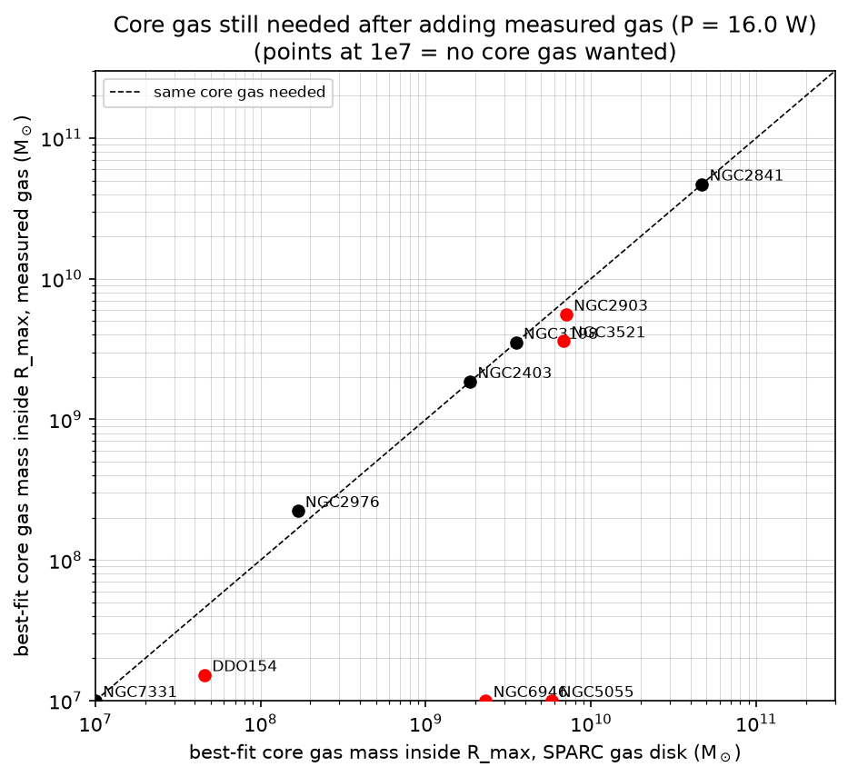
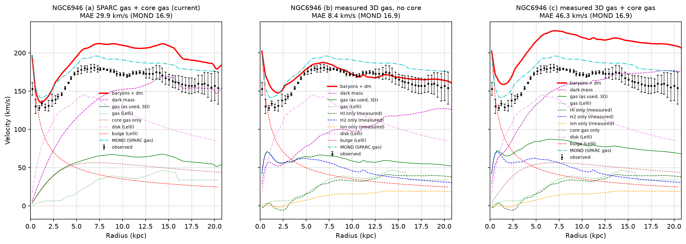
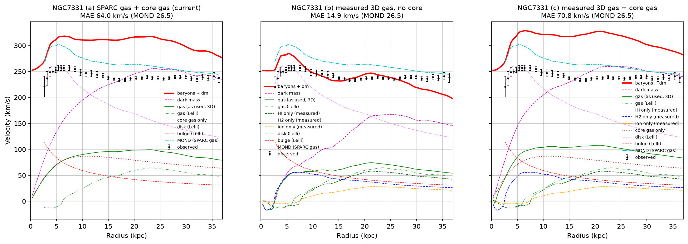
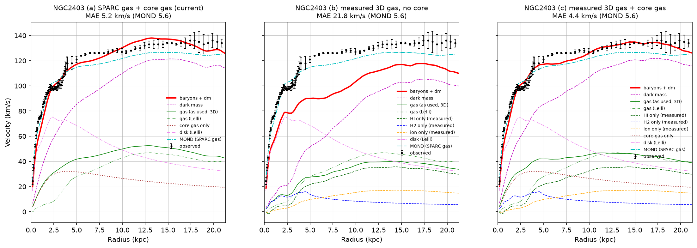

# 3D gas test: 10 SPARC galaxies with THINGS HI + HERACLES CO (P = 16 W)

**Question.** The dark-mass model (ρ_dm = (P/c³) n^(2/3)) fits SPARC about as well as MOND, but only with unobserved spherical "core gas". The thesis is that measuring *all* the gas properly in 3D (HI + H2 + ionized, each phase with its own thickness) would improve the fit and reduce the need for that core gas. This tests the thesis on every SPARC galaxy that has both a THINGS HI map and a HERACLES CO map. Two are left out: NGC 4214 (inclination 15°) and NGC 2366 (SPARC quality 3).

**Failure condition (written down before reading the results).** If complete measured gas gives no improvement in fit and adds little gas compared with what the core term supplies, then measured gas does not support the core-gas term. In that case the core gas stays an unobserved component the model needs, not a stand-in for gas we already know about.

**Short answer at 16 W.** Measured gas supports the thesis in 3 of 10 galaxies (NGC 6946, 3521, 7331), weakly in 1 (NGC 2903), and fails in 6. MOND with no extra component still fits 7 of 10 better than measured gas without a core. These conclusions depend strongly on P: at 9.2 W no galaxy could drop the core term (see "How much depends on P").

## Setup

All runs: P = 16 W fixed, CGM off, Υ_disk = 0.5, Υ_bulge = 0.7, the same brute-force grid (`num_minutes=5`, z layers sinh-spaced with A = 0.02 kpc, see "Grid note" below). Residuals are taken at the observed radii, using the model's own 3D gas gravity (`Vgas_test`) in every variant. P = 16 W is taken as given; it was not fitted to these 10 galaxies.

| variant | gas disk | core gas |
|---|---|---|
| a0 | SPARC Σ_gas column (inverted from Lelli Vgas), h_z = 0.196 R_d^0.633 | off |
| **a** (current) | SPARC Σ_gas column | n0 = 0.6 cm⁻³ for every galaxy, β 2.25, r_core_factor 2.5 |
| **b** | measured HI + H2 + ionized | off |
| **c** | measured HI + H2 + ionized | same as a |

The core gas density is n0 (1 + r²/r_c²)^(−β), with r_c = 2.5 × 2(M_b/1e11)^(1/3) kpc.

"Best n0" comes from scanning n0 = 0, 0.15, 0.2, 0.25, 0.3, 0.38, 0.45, 0.6, 0.8, 1.0, 1.3, 1.7, 2.2 cm⁻³ with everything else fixed. Nothing was tried between 0 and 0.15, so a best n0 of 0 means "below about 0.15". "Core mass" is the extra gas the best-fit core puts inside a sphere of radius R_max. The best-n0 columns tune one parameter per galaxy, so they are not a like-for-like comparison with a, b, c or MOND.

## Results: all 10 galaxies

Mean |V_obs − V_model| (km/s) at observed radii, sorted by V_max. Masses are in M☉ inside R_max, ×1.33 for helium; the measured mass includes the assumed ionized layer. Full numbers, including χ² (dominated by the small error bars in some galaxies), are in `results.json`.

| galaxy | V_max | a0 SPARC, no core | a SPARC + core | b measured, no core | c measured + core | MOND | best n0 SPARC (MAE) | best n0 measured (MAE) | core mass SPARC | core mass measured | gas SPARC disk | gas measured |
|---|---|---|---|---|---|---|---|---|---|---|---|---|
| DDO154 | 48 | 5.0 | 1.7 | 4.7 | 5.3 | 4.1 | 0.60 (1.7) | 0.20 (4.0) | 4.6e7 | 1.5e7 | 2.4e8 | 4.1e8 |
| NGC2976 | 89 | 6.1 | 1.9 | 8.7 | 1.6 | 5.3 | 0.45 (1.5) | 0.60 (1.6) | 1.7e8 | 2.2e8 | 2.6e8 | 2.0e8 |
| NGC2403 | 136 | 22.5 | 5.2 | 21.8 | 4.4 | 5.6 | 0.60 (5.2) | 0.60 (4.4) | 1.9e9 | 1.9e9 | 5.4e9 | 4.3e9 |
| NGC3198 | 157 | 25.5 | 18.8 | 25.5 | 25.7 | 8.1 | 0.30 (8.2) | 0.30 (13.3) | 3.5e9 | 3.5e9 | 1.4e10 | 1.7e10 |
| NGC6946 | 181 | 18.3 | 29.9 | 8.4 | 46.3 | 16.9 | 0.15 (5.2) | 0 (8.4) | 2.3e9 | 0 | 4.1e9 | 1.0e10 |
| NGC5055 | 206 | 13.3 | 48.5 | 16.6 | 56.7 | 29.3 | 0.15 (13.2) | 0 (16.6) | 5.8e9 | 0 | 1.5e10 | 2.0e10 |
| NGC2903 | 216 | 35.5 | 20.3 | 30.5 | 25.7 | 12.4 | 0.38 (11.8) | 0.30 (13.1) | 7.1e9 | 5.6e9 | 3.8e9 | 5.5e9 |
| NGC3521 | 220 | 23.2 | 11.6 | 13.5 | 17.6 | 5.9 | 0.38 (6.0) | 0.20 (6.7) | 6.8e9 | 3.6e9 | 5.0e9 | 8.5e9 |
| NGC7331 | 257 | 18.5 | 64.0 | 14.9 | 70.8 | 26.5 | 0 (18.5) | 0 (14.9) | 0 | 0 | 1.5e10 | 2.1e10 |
| NGC2841 | 323 | 87.8 | 26.0 | 105.1 | 36.6 | 52.3 | 1.00 (12.6) | 1.00 (11.6) | 4.7e10 | 4.7e10 | 4.1e10 | 1.5e10 |

Mean and median MAE over the sample (km/s):

| | a0 | a | b | c | MOND |
|---|---|---|---|---|---|
| all 10, mean / median | 25.6 / 20.5 | 22.8 / 19.5 | 25.0 / 15.7 | 29.1 / 25.7 | 16.6 / 10.2 |
| without NGC 2841, mean / median | 18.6 / 18.5 | 22.4 / 18.8 | 16.0 / 14.9 | 28.2 / 25.7 | 12.7 / 8.1 |

Sensitivity of variant (b) (MAE km/s). α_CO is scaled by a flat factor at all radii.

| galaxy | b | α_CO × 0.5 | α_CO × 2 | no ionized layer | MOND with measured gas |
|---|---|---|---|---|---|
| DDO154 | 4.7 | 4.8 | 4.7 | 4.9 | 5.8 |
| NGC2976 | 8.7 | 9.3 | 7.5 | 9.5 | 4.3 |
| NGC2403 | 21.8 | 22.7 | 20.1 | 26.7 | 7.3 |
| NGC3198 | 25.5 | 26.7 | 23.1 | 24.8 | 10.8 |
| NGC6946 | 8.4 | 7.1 | 19.3 | 8.5 | 25.9 |
| NGC5055 | 16.6 | 14.5 | 20.6 | 18.2 | 33.8 |
| NGC2903 | 30.5 | 31.3 | 29.7 | 34.2 | 13.3 |
| NGC3521 | 13.5 | 17.3 | 9.0 | 15.3 | 7.7 |
| NGC7331 | 14.9 | 15.2 | 17.5 | 18.9 | 30.0 |
| NGC2841 | 105.1 | 106.1 | 103.2 | 109.1 | 58.2 |



Per-galaxy plots: `<GAL>_3dgas_variants.png` (variants a/b/c, with HI, H2, ionized and core gas shown separately), `<GAL>_core_scan.png`, and `<GAL>_profiles.png` (measured profiles against SPARC Σ and Leroy et al. 2008).





## Verdict against the failure condition

**Pattern across the 10 galaxies:**
- **Measured gas without core (b vs a0)** clearly improves the fit in 4 galaxies: NGC 6946, 3521, 2903 and 7331. It is about the same in NGC 2403, 3198 and DDO 154, and worse in NGC 5055, 2976 and 2841.
- **Measured gas without core vs the current model (b vs a):** b wins in NGC 6946, 5055 and 7331, where a flat n0 = 0.6 overshoots badly (a is worse than a0 in all three). The current model wins in the other 7.
- **Best-fit core gas with measured gas** is zero in NGC 6946, 5055 and 7331, about half in NGC 3521, 20% lower in NGC 2903, a third of a very small value in DDO 154, unchanged in NGC 2403, 3198 and 2841, and higher in NGC 2976. Two of the zeros don't count as a gain from measured gas: NGC 7331 already wants none with SPARC gas, and in NGC 5055 the SPARC-gas core only improves the fit from 13.3 to 13.2 km/s.
- **Best fits with a tuned core** are worse with measured gas than with SPARC gas in 6 of 10 (DDO 154, NGC 3198, 6946, 5055, 2903, 3521), about equal in NGC 2976, and better in NGC 2403, 7331 and 2841.
- **A single n0 doesn't fit the sample.** Best n0 with SPARC gas runs from 0 to 1.0 and doesn't track mass in any simple way. Adding the n0 = 0.6 core on top of measured gas (c) overshoots by 5 km/s or more on average in 7 of 10 galaxies.

**By galaxy:**
- **Thesis supported (3):**
  - **NGC 6946:** the error drops from 18.3 to 8.4 km/s with no core at all, and gas rises from 4.1e9 to 1.0e10 M☉. This survives α_CO × 0.5 (7.1 km/s), so it no longer relies on the Galactic α_CO in the centre, and it doesn't need the ionized layer (8.5). α_CO × 2 breaks it (19.3). The model still overshoots at R ≈ 1–2.5 kpc.
  - **NGC 3521:** the error drops from 23.2 to 13.5 km/s and the best-fit core halves. The improvement survives α_CO × 0.5 (17.3), but the fit prefers more H2 (9.0 at α_CO × 2).
  - **NGC 7331:** the error drops from 18.5 to 14.9 km/s, but without the assumed ionized layer the gain is gone (18.9). The model also falls about 40 km/s short at the outermost radii. It needs no core gas either way.
- **Weak support (1):** **NGC 2903.** The error improves from 35.5 to 30.5 km/s, still poor, and the core falls only 20%. The remaining core is about equal to all the measured gas.
- **Failure condition met (6):**
  - **NGC 2403:** measured gas is less than the SPARC column and the fit doesn't change (22.5 → 21.8). The core need is unchanged.
  - **NGC 3198:** 20% more gas, the same no-core fit (25.5), and the same core need. MOND is at 8.1.
  - **NGC 2976:** less gas, a worse fit, and a higher core need.
  - **NGC 5055:** more gas but a worse fit (13.3 → 16.6). The SPARC-gas fit already needed no core.
  - **DDO 154:** the no-core fit barely moves (5.0 → 4.7). The core falls, but the best fit gets worse (1.7 → 4.0).
  - **NGC 2841:** still far too low without a core (105 km/s). The core needed is 4.7e10 M☉, 3.1× all the measured gas. MOND is also poor here (52 km/s), so the stellar mass model or the distance may be part of this.

**Overall:** the results are mixed and no longer a clear rejection. At 16 W, measured gas can replace the core term where a galaxy has a lot of H2 and is massive (NGC 6946 is the best case, though NGC 5055 is H2-rich and doesn't benefit). In galaxies with little H2, it doesn't: NGC 2403 and NGC 2976 still want n0 ≈ 0.5–0.6, and NGC 2841 wants about 1. The core gas those galaxies need still has to be something unobserved, such as halo gas. MOND remains the better fit overall (median 10.2 km/s vs 15.7 for b and 19.5 for a) with no extra component, and beats b in 7 of 10.

## How much depends on P

The 9.2 W version of this test is at commit 14036fb on branch `claude/3d-gas-test-e71220`. It concluded that no galaxy could drop the core term. The no-core variants a0 and b don't use the core settings, so these columns differ only through P, plus Υ_bulge (0.6 → 0.7), which matters only for NGC 6946, 7331 and 2841.

| galaxy | a0 at 9.2 W | a0 at 16 W | b at 9.2 W | b at 16 W |
|---|---|---|---|---|
| DDO154 | 10.8 | 5.0 | 6.4 | 4.7 |
| NGC2976 | 8.8 | 6.1 | 10.7 | 8.7 |
| NGC2403 | 30.7 | 22.5 | 30.4 | 21.8 |
| NGC3198 | 33.5 | 25.5 | 26.1 | 25.5 |
| NGC6946 | 26.8 | 18.3 | 12.9 | 8.4 |
| NGC5055 | 24.2 | 13.3 | 21.8 | 16.6 |
| NGC2903 | 41.8 | 35.5 | 37.8 | 30.5 |
| NGC3521 | 25.6 | 23.2 | 18.2 | 13.5 |
| NGC7331 | 31.5 | 18.5 | 26.7 | 14.9 |
| NGC2841 | 106.5 | 87.8 | 119.5 | 105.1 |

Raising P does more to reduce the core gas than measured gas does. Summing best-fit core mass over the 9 galaxies without NGC 2841:

| | total best-fit core mass (M☉) |
|---|---|
| 9.2 W, SPARC gas (β 1.93, n0 with mass correction) | 7.7e10 |
| 16 W, SPARC gas (β 2.25, flat n0) | 2.8e10 |
| 16 W, measured gas (β 2.25, flat n0) | 1.5e10 |

P and core gas trade off, so a reduced core at 16 W is not by itself evidence for the thesis. The test is only as strong as the independent case for P. A cleaner version would fit P and one global n0 together, with SPARC gas and with measured gas, and compare the best fits.

## What changed from the 9.2 W run

| setting | 9.2 W run | this run |
|---|---|---|
| P | 9.2 W | 16 W |
| core β | 1.93 | 2.25 |
| core n0 | 0.6 + 0.09(9.5 − log M_b) | 0.6, same for every galaxy; the scan is in n0 directly |
| Υ_bulge | 0.6 | 0.7 (moves MOND for NGC 6946, 7331, 2841) |
| `num_minutes` | 8 | 5 |

Other model settings that don't affect these runs because the CGM term is off: r_core_factor_cgm 0.25, cgm_beta 0.68. The measured gas profiles are unchanged.

## Assumptions

- **Distances:** SPARC values, so radii match the rotation curves. Several differ from the THINGS distances, e.g. NGC 2903 6.6 vs 8.9 Mpc and NGC 3521 7.7 vs 10.7 Mpc.
- **Map geometry:** de Blok et al. 2008, Table 2, listed in `GALAXIES` in `gas3d_build_profiles.py`. The rotation curves are SPARC's own, at SPARC inclinations. For NGC 6946 the inclination difference (32.6° vs 38°) alone is a ~14% change in deprojected V_obs, which is larger than the 8.4 km/s residual.
- **HI:** N_HI = 1.823e18 ∫T_B dv, with THINGS natural-weighted beams taken from the map headers. Face-on Σ = N cos i. Helium enters as ×1.33 in the model's mass, as for SPARC. Beyond the last ring with ≥60% azimuthal THINGS coverage, HI falls back to the SPARC Σ column. That only affects NGC 2403 beyond 23.6 kpc and NGC 5055 beyond 52 kpc.
- **H2:** α_CO(1-0) = 4.35 M☉ pc⁻² (K km/s)⁻¹ including He (Bolatto et al. 2013), uncertain by ±0.3 dex and likely 5–10× lower in the centre of NGC 6946 (Sandstrom et al. 2013). R21 = CO(2-1)/CO(1-0) = 0.7 (den Brok et al. 2021: 0.65 ± 0.2). This gives Σ_H2(incl. He) = 6.2 I_CO(2-1). H2 is counted as 2 H nuclei per molecule, the same convention as the SPARC Σ column. If each molecule counted as one particle, the H2 contribution to n^(2/3) would drop by 2^(2/3) = 1.6. CO is set to zero in rings HERACLES covers less than 60% of, and negative ring means (noise, as in DDO 154) are clipped to zero.
- **Ionized gas:** not measured. Σ_ion = 0.25 Σ_HI with an exponential scale height of 1 kpc. This follows the Milky Way, where pulsar dispersion measures give N_e ≈ 1.4e20 cm⁻² through the disk against N_HI ≈ 6e20 cm⁻².
- **Vertical profiles** (exponential, renormalised on the actual z layers so each phase keeps its column): HI h = 0.15 + 0.025 R kpc (flaring; this reaches ~1.9 kpc at 70 kpc in NGC 2841), H2 h = 0.05 kpc, ionized h = 1.0 kpc.
- **Axisymmetry:** measured profiles are azimuthal ring averages, like the rotation curve. Clumping at map resolution, ⟨Σ^(2/3)⟩/⟨Σ⟩^(2/3), is mostly 0.9–0.97 (column `clump_HI_H2` in the CSVs). Including it would *lower* the dark mass from measured gas by a few percent. That is not applied here.

## Data checks

- **Per-phase gas curves.** In NGC 2403 the measured H2 rises to 15.4 km/s at 4 kpc and falls to ~6.7 km/s at 15 kpc. This matches Frank et al. (2016, Fig. 10: ~15–16 km/s at 3.5–4 kpc, ~6 km/s at 18 kpc), so H2 is included correctly. It barely shows in the summed gas line because velocities add in quadrature.
- **HI and H2 profiles** match Leroy et al. (2008) after rescaling their radii to the SPARC distances (`*_profiles.png`). Integrated THINGS HI masses agree with Walter et al. 2008 rescaled to the SPARC distances. For example: NGC 2403 2.5e9, NGC 6946 3.6e9, NGC 3198 9.8e9, NGC 7331 9.1e9 M☉ (hydrogen only).
- **THINGS is not "complete" HI.** SPARC's HI masses often come from deeper WSRT data and are higher, e.g. 3.2e9 vs 2.5e9 M☉ for NGC 2403 and 5.7e9 vs 3.6e9 for NGC 6946. The missing HI is mostly diffuse and outer/extraplanar. It could help outer deficits somewhat, but is small next to what NGC 2841 asks for.
- **The SPARC Σ_gas column made by `calc_gas_checkit.py` seems to inflate the gas in some galaxies.** NGC 2403: 4.0e9 M☉ (H only) to R_max, against SPARC M_HI 3.2e9 and THINGS 2.5e9. NGC 2841: the SPARC-disk gas inside R_max is 4.1e10 M☉, against 1.5e10 measured (SPARC M_HI is 9.8e9). This may flatter the SPARC-gas variants (a0, a) in those galaxies. The Vgas inversion is worth checking.

## Grid note

All variants here use `z_stretch_kpc=0.02` (sinh-spaced z layers), which resolves the 50 pc H2 layer without losing mass. With a uniform z grid, layers would be about 0.27 kpc thick at `num_minutes=5`, about one disk scale height. A 50 pc H2 layer would then get ~2× its mass and be smeared in n^(2/3). As a result, variant (a) here is not numerically identical to a default-grid run. In a low-resolution check at 9.2 W, the uniform vs stretched grid moved variant (a) by 0.7 km/s (NGC 6946) and 2.4 km/s (NGC 2403).

**Convergence:** rerunning variants a and b at `num_minutes=8` changed every galaxy by 0.2 km/s or less.

## Data sources

- THINGS HI moment-0 maps, natural weighting (Walter et al. 2008, AJ 136, 2563): https://things.www3.mpia.de/Data_files/ — `<GAL>_NA_MOM0_THINGS.FITS`
- HERACLES CO(2-1) moment-0 maps (Leroy et al. 2009, AJ 137, 4670): https://www.iram.fr/ILPA/LP001/ — `<gal>_heracles_mom0.fits.gz` (+ `emom0`)
- Leroy et al. 2008 radial profiles (cross-check): https://cdsarc.cds.unistra.fr/ftp/J/AJ/136/2782/
- Geometry: de Blok et al. 2008, AJ 136, 2648, Table 2
- Raw downloads live in `raw/` next to this note (~58 MB, git-ignored; re-download from the URLs above). FITS files were read only with `python -I`. Raw model run output goes to `runs/` (git-ignored, regenerated by the driver).

## Reproduce

```bash
.venv/bin/pip install astropy
.venv/bin/python -I sparc/gas3d/gas3d_build_profiles.py   # FITS in sparc/gas3d/raw -> sparc/gas3d/<GAL>_profiles.csv/.png
.venv/bin/python sparc/gas3d/gas3d_test.py                # all variants + core scan for 10 galaxies, ~20-25 min
```
